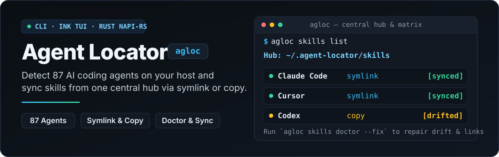
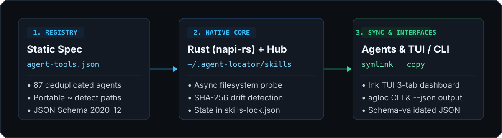

<p align="center">
  
</p>

# Agent Locator (`agloc`)

**Detect installed AI coding agents on your machine and manage their skills from one central hub (`~/.agent-locator/skills`) using `symlink` or `copy` mode.**

Built with a **Rust (`napi-rs`)** native filesystem & hashing core and a **TypeScript (`Ink` + `citty`)** CLI and interactive TUI, backed by a static, schema-validated registry of **87 known AI coding agents** ([`agent-tools.json`](./agent-tools.json)).

---

## Quick Start

### 1. Build from source

Requires **Node.js** and a **Rust toolchain** (`cargo`).

```bash
npm install
npm run build
```

This compiles the Rust native addon (`agent-locator.node`) and TypeScript CLI (`dist/index.js`).

### 2. Scan your machine

```bash
# Run a read-only host scan (validates output against JSON Schema Draft 2020-12)
node dist/index.js scan

# Or launch the interactive 3-tab Ink TUI dashboard
node dist/index.js
```

> If linked globally (`npm link`), use `agloc` or `agent-locator` directly in place of `node dist/index.js`.

Example `scan` output:

```text
Agent Locator Scan Summary
Host: workstation (linux) | Home: /home/user
Checked: 87 | Installed: 2 | Not installed: 85 | Duration: PT0S

● Gemini CLI (gemini_cli) — 0 skills [~/.gemini]
    ~/.gemini/skills: missing
● Antigravity CLI (antigravity-cli) — 0 skills [~/.gemini/antigravity-cli]
    ~/.gemini/config/skills: missing
```

---

## How It Works

<p align="center">
  
</p>

1. **Universal Agent Registry ([`agent-tools.json`](./agent-tools.json))**: A host-independent catalog of **87 deduplicated AI coding agents** merged from [`xingkongliang/skills-manager`](https://github.com/xingkongliang/skills-manager) (56 agents) and [`vercel-labs/skills`](https://github.com/vercel-labs/skills) (79 agents). Uses portable `~` paths and never stores local machine state.
2. **Rust Native Core (`rust/`)**: Probes `detect_paths` and `global_skills_dirs` asynchronously via `tokio` + `napi-rs`, resolves symlinks, computes SHA-256 content hashes for skill directories, and records managed state.
3. **Central Skill Hub (`~/.agent-locator/skills`)**: Stores canonical skill folders once, then distributes them to any installed agent as either a **symlink** or a **copy**, while `doctor` detects broken links, drifted copies, unmanaged agent skills, and missing `SKILL.md` files.

---

## CLI Reference

### Interactive TUI

```bash
agloc            # Launch TUI (default when no subcommand is passed)
agloc tui        # Explicit TUI subcommand
```

TUI views & shortcuts: `[1]` Agents Overview · `[2]` Skills Matrix · `[3]` Doctor · `Tab` switch view · `r` refresh · `q` quit.

### Scanning & Agent Inspection

```bash
agloc scan                          # Human-readable host scan summary
agloc scan --json                   # Full scan result JSON to stdout
agloc scan -o scan-result.json      # Save & validate against agent-tools-scan-result-schema.json

agloc agents list                   # List installed agents
agloc agents list --all             # List all 87 known agents
agloc agents list -c coding --json  # Filter by category and output JSON
agloc agents info claude_code       # Inspect detect paths, symlinks, and skills for an agent
```

### Skill Hub & Distribution

```bash
# List central-hub and unmanaged agent skills with sync status
agloc skills list
agloc skills list --agent cursor --json

# Add a local skill folder to ~/.agent-locator/skills and distribute immediately
agloc skills add ./my-skill --to claude_code,cursor -m symlink
agloc skills add ./my-skill --to all -m copy

# Import existing unmanaged skills from agents into the central hub
agloc skills import --from claude_code --skill my-skill -m symlink
agloc skills import --all -m symlink

# Distribute, remove, sync, and repair
agloc skills link my-skill --to claude_code,codex
agloc skills copy my-skill --to cursor
agloc skills remove my-skill --from codex
agloc skills sync
agloc skills doctor                 # Check for broken symlinks, drifted copies, missing SKILL.md
agloc skills doctor --fix           # Auto-repair fixable issues
```

---

## Repository Layout & Schemas

| Path | Role |
| :--- | :--- |
| [`rust/`](./rust) | Rust `napi-rs` native core (`scanner.rs`, `skills.rs`, `state.rs`, `models.rs`) |
| [`src/`](./src) | TypeScript CLI (`commands/`), Ink TUI (`tui/`), and native bindings (`native.ts`) |
| [`agent-tools.json`](./agent-tools.json) | Universal static registry of 87 known AI coding agents |
| [`agent-tools-schema.json`](./agent-tools-schema.json) | JSON Schema (Draft 2020-12) for `agent-tools.json` |
| [`agent-tools-scan-result-schema.json`](./agent-tools-scan-result-schema.json) | JSON Schema (Draft 2020-12) for host scan results (`date-time`, `duration`, `hostname`) |
| [`known-agents.md`](./known-agents.md) | Human-readable table of all 87 known agents |
| [`known-agents.json`](./known-agents.json) / [`known-agents-schema.json`](./known-agents-schema.json) | Initial merged registry snapshot and its Draft 2020-12 schema |

---

## Development & Testing

```bash
npm run build:rust   # Build Rust cdylib and copy .node binary
npm run build:ts     # Compile TypeScript to dist/
npm test             # Run Cargo tests and Node CLI/TUI tests
```
